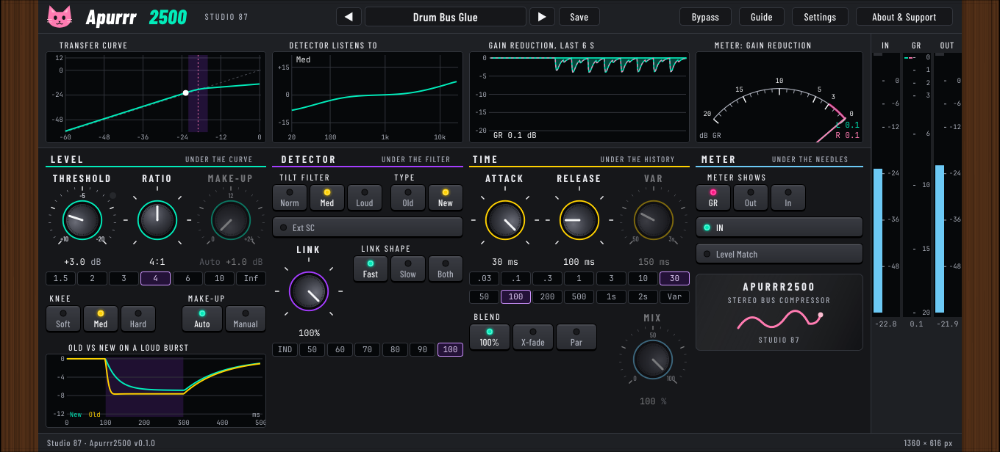

# Apurrr2500

A free, open source, cat-themed stereo bus compressor (VST3, Linux first), made for gluing a mix together.

Screenshot of the compiled plugin window, rendered offscreen by tools/snapshot.cpp.

## Status
Version 0.1.0 is a test build (pre-release). The VST3 plugin is built from the approved design mockup (`docs/mockup/`), which stays in the repo as the reference. See [ROADMAP.md](ROADMAP.md) for what is verified and what is not.

## Download
Get the latest zip from the [Releases page](https://github.com/SpeakingColors/apurrr2500/releases): installers for Windows (.exe) and macOS (.pkg), a Flatpak extension and a plain .vst3 tarball for Linux, a PDF manual, INSTALL.txt and SHA256SUMS. Everything works offline.

**About the "unknown publisher" warnings:** the installers are not signed (signing needs a paid certificate; this is a free project). Windows may show "Windows protected your PC": click More info, then Run anyway. macOS may block the package: open System Settings, Privacy and Security, and choose Open Anyway. Checksums are in SHA256SUMS and the source is here.

## Manual
[Manual (web page)](https://github.com/SpeakingColors/apurrr2500/blob/main/docs/manual.html) is built from the real window; the PDF ships in the release zip.

## Controls
Threshold, Ratio, Make-up (Auto or Manual), Knee, Attack, Release (and Var), Tilt filter, Type (Old or New), Ext SC side-chain, Link and Link shape, Blend (100 %, X-fade, Par) and Mix, IN, Level Match, Bypass, three meters with dB scales, 16 factory presets plus your own. Every control has a hover info bubble.

## Build
`sh tests/run.sh` runs the core DSP tests (no JUCE). `cmake -S . -B build -DCMAKE_BUILD_TYPE=Release` builds the VST3 (JUCE is fetched). Needs Linux dev packages for JUCE (ALSA, X11, FreeType, fontconfig).

## Privacy
Collects nothing. No network access.

## Support

  

Free and open source, made by one person. If it helps your music, a coffee on [Ko-fi](https://ko-fi.com/studio87) keeps it coming.

## License
AGPL-3.0-or-later, see [LICENSE](LICENSE).
